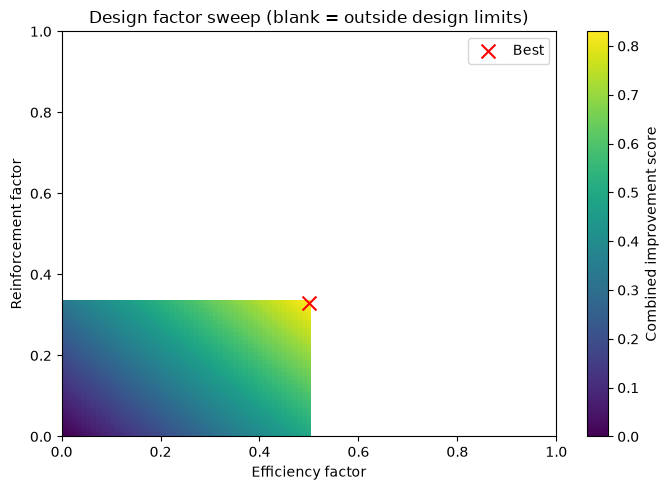

  

## File Overview

### Task 1: Control System Diagnostics
- **Notebook**: `Control_System_Diagnostics_Notebook.ipynb`
  - Diagnose and optimize the robotic arm’s control system.
  - Identify delays in commands like `rotate_joint`, `move_arm`, and `adjust_grip`.
- **Resource**: [Diagnostics Guide](./Diagnostics_Guide.pdf)
  - Detailed instructions on troubleshooting and optimizing control code.

### Task 2: Design Optimization
- **Notebook**: `Robotic_Arm_Design_Simulation.ipynb`
  - Simulate design modifications for improved response times and durability.
  - Test factors like efficiency and reinforcement using provided tools.
- **Resource**: [Design Optimization Principles](./Design_Optimization_Principles.pdf)
  - Learn the fundamentals of design optimization and real-world applications.

#### Part 2 Results: Design Optimization

The simulation models response time as decreasing with the efficiency factor and durability as increasing with the reinforcement factor:

- `new response time = 0.20 s × (1 − efficiency factor)`
- `new durability = 75 × (1 + reinforcement factor)`

The notebook evaluates all 10,201 pairs of factors from 0.00 to 1.00 in increments of 0.01. Valid results meet the 0.10-second response-time target and do not exceed the durability limit of 100. The combined score adds percentage response-time reduction and percentage durability gain with equal weighting.

| Metric | Baseline | Optimized |
| --- | ---: | ---: |
| Efficiency factor | — | 0.50 (50%) |
| Reinforcement factor | — | 0.33 (33%) |
| Response time | 0.20 s | 0.10 s |
| Durability score | 75.00 | 99.75 |
| Combined improvement score | — | 0.830 |

The sweep found 1,734 valid combinations. The selected factors reach the response-time target and bring durability close to, but not over, its maximum. In this simplified linear model, a 50% efficiency improvement halves response time, while 33% reinforcement adds 24.75 durability points.

These are simulation results, not measured hardware performance. The linear relationships and limits are exercise assumptions; a real design requires engineering review and physical testing.

---

## How to Use

1. Open the relevant `.ipynb` file in Jupyter Notebook or a compatible Python environment.
2. Follow the step-by-step instructions in each notebook to complete the tasks.
3. Use the provided templates and guides for documentation and proposals.

---

## Contribution Guidelines
We welcome contributions to improve the repository! If you have suggestions or find issues, please create a pull request or submit an issue.

---

## License
This repository is for educational purposes as part of the Johnson & Johnson Robotics Control System Simulation Program. The content and tools are not intended for commercial use.

---

## Disclaimer
The robotic designs and simulations provided in this repository are educational approximations. They do not represent actual Johnson & Johnson robotic systems.

# J-J-Robotic-Arm-Design-Optimization
